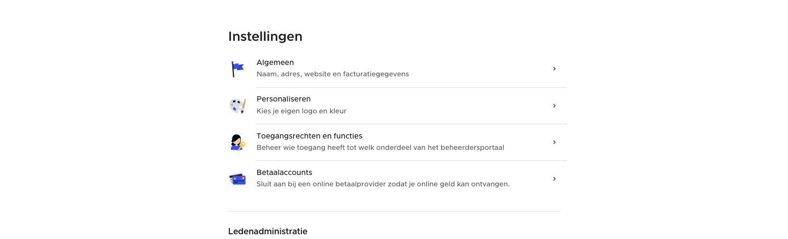

# View building blocks (inline components and classes)

> You should rarely write custom CSS. Consult other reference views in the code before writing custom css - you might be missing some existing classes, helpers or components.

Also check out [View API’s](view-apis.md)

---

## STView

.st-view class is used for all views. It sets the most important styles for displaying the view like scrolling and padding. Views won’t work without this class.

**Centering content**

On desktop, a full-screen view centers its content in a column (`--st-view-max-width`, 700px by default). Add `.small` to the \<main\> element for a narrow 400px column, e.g. for login forms. Centering is switched off in popups, sheets (including positionable sheets), a `BoxedController`, a split-view sidebar, and for views nested inside the \<main\> of another view.

The toolbar at the bottom aligns with the content column and follows the content instead of floating at the bottom of the screen. It only sticks to the bottom (with a top border) when the content scrolls. On mobile it floats as before.

Add `.full-width` to the view or its \<main\> when the content needs all available space, such as tables, menus or views that set their own width.

```html
<template>
    <div class="st-view">
        <STNavigationBar :title="$t('My View')" />

        <main>
            <h1>
                {{ $t('My View') }}
            </h1>
            <!-- ... -->
        </main>
    </div>
</template>
```

The navigation bar keeps the full width by default. Add `.center-navigation-bar` to the view, or to a container around the views, to align it with the content column as well.



---

## PreviewPanel

Wraps a view (or a `NavigationController`) to show a preview next to it, e.g. the cart during checkout or a preview of the webshop in the dashboard. The view keeps its own navigation bar, scrolling and toolbar.

When the panel is at least 900px wide, the preview is shown in its own scrollable column with a `background-shade` background. The column is at least `--preview-panel-width` wide (450px by default). On large displays the content of the view moves next to the preview (`--preview-panel-gap`, 80px by default) and both are centered together on the screen; the preview keeps the width it has in the narrowest column. Below that width, the preview moves to the end of the view's \<main\>, so it scrolls together with the content instead of splitting a small screen in two.

A view chooses where the preview goes on small screens by adding a `<PreviewOutlet />`, usually at the end of its \<main\>. A view without an outlet hides the preview on small screens, e.g. to offer a button that opens it instead. When views are pushed inside the panel, the most recent outlet takes over the preview. The preview stays mounted while it moves, so it keeps its state.

The `#actions` slot is shown below the preview, only while the preview has its own column. The default slot receives `wide`, so the view can move a button there on wide screens and keep it in its own toolbar otherwise (`hideToolbar` on `SaveView`):

```html
<template>
    <PreviewPanel>
        <template #default="{ wide }">
            <SaveView :title="$t('My View')" :hide-toolbar="wide" @save="save">
                <h1>{{ $t('My View') }}</h1>
                <!-- ... -->

                <PreviewOutlet />
            </SaveView>
        </template>

        <template #preview>
            <!-- ... -->
        </template>

        <template #actions>
            <LoadingButton :loading="saving" class="max">
                <button class="button primary full" type="button" @click="save">
                    {{ $t('Confirm') }}
                </button>
            </LoadingButton>
        </template>
    </PreviewPanel>
</template>
```

---

## STNavigationBar

This is the bar at the top of all views. Normally every view has this bar. The navigation bar automatically adds a back and close button depending on how and where the view is displayed.

**Disable pop or dismiss buttons**

By default the back and dismiss buttons are added automatically. This can be disabled by setting disable-pop or disable-dismiss to true.

**Only the safe area**

Set `safe-area-only` when a surrounding container shows its own bar in the safe area of the view (like the webshop's `WebshopController`). The navigation bar then takes no height and only gives that area a background once the view scrolls.

```html
<STNavigationBar :title="title" :disable-pop="true" :disable-dismiss="true" />
```

**Adding buttons**

You can add buttons in the #right slot. The `navigation` class should be added to buttons when they are placed in this slot.

```html
<STNavigationBar :title="title">
    <template #right>
        <button class="button navigation highlight" type="submit">
            Save
        </button>
    </template>
</STNavigationBar>
```

---

## STList and STListItem

*Please also read source at `frontend/shared/components/src/layout`*

These important components are used very often. They render multiple items in a list, and put lines between them, in accordance with our design system.

```html
 <STList>
    <STListItem>
        <h3 class="style-title-list">
            My list title
        </h3>
        <p class="style-description-small">
            My description
        </p>
    </STListItem>
    
    <STListItem>
        <h3 class="style-title-list">
            My list title
        </h3>
        <p class="style-description-small">
            My description
        </p>
    </STListItem>
</STList>
```

**With icon containers:**

Icon containers are mostly used for secondary actions that can’t be added in the navigation bar. E.g. adding a new balance item, closing a webshop…

```html
  <STList>
      <STListItem :selectable="true" element-name="button" @click="createBalanceItem">
          <template #left>
              <IconContainer icon="box">
                  <template #aside>
                      <span class="icon add small primary" />
                  </template>
              </IconContainer>
          </template>
          <h3 class="style-title-list">
              Title
          </h3>
          <p class="style-description-small">
              Description
          </p>

          <template #right>
              <span class="icon arrow-right-small gray" />
          </template>
      </STListItem>
  </STList>
```

**With illustrations:**

Illustrations in lists are only used in setting overviews.

```html
 <STList class="illustration-list">
		 <STListItem :selectable="true" class="left-center">
          <template #left>
              
          </template>
          <h2 class="style-title-list">
              Title
          </h2>
          <p class="style-description">
              Description
          </p>
          <template #right>
              <span class="icon arrow-right-small gray" />
          </template>
      </STListItem>
</STList>
```

**Draggable list**

Items can be made draggable. Add a drag icon to the right side of your list items, this will be the drag zone where you can drag the list items.

```html
<template>
		<STList v-model="draggableTypes" :draggable="true">
		    <template #item="{item: type}">
		        <STListItem :selectable="true" class="right-stack">
				        <h2 class="style-title-list">
				            {{ type.title }}
				        </h2>
				        <p class="style-description-small">
				            {{ type.description }}
				        </p>
				
				        <template #right>
				            <span class="button icon drag gray" @click.stop @contextmenu.stop />
				            <span class="icon arrow-right-small gray" />
				        </template>
				    </STListItem>
		    </template>
		</STList>
</template>

<script lang="ts" setup>
...
// You can use a helper hook such as useDraggableArray or useDraggableArrayIds
// this is a computed property that maps the v-model and patches the array for you
const { patched, addArrayPatch } = usePatchArray(originalTypes);
const draggableTypes = useDraggableArray(() => patched.value, addArrayPatch);
</script>
```

[Patching inside views](patching.md)

#### List item options

- `selectable`: makes a list item clickable, adds the right styling, hover state and changes the element tag to a button or label.
- `disabled`: gives the item a disabled state and cursor
- `class`
    - `right-stack`: place items in the right slot side by side
    - `no-padding`: removes default padding (don’t use this unless really required)

---

## SaveView

Depending on the operating system and device this view will display the save and delete buttons on other locations. On iOS the save button will be placed at the top, for example. While on desktop the save button will be placed at the bottom of the form.

Example usage: `frontend/shared/components/src/groups/EditGroupView.vue`

---

## Icons

All icons are 24x24px. They automatically use the current text color.

The icon names are wrapped to css classes automatically.

```html
<span class="icon edit" />
<span class="icon arrow-down" />
<span class="icon bank" />
```

*All icons can be found in `frontend/shared/assets/images/icons`*

> You need to restart `yarn dev:*` after adjusting icons in the icons folder

---

## Text styles

*Source in `frontend/shared/scss/base/text-styles.scss`*

Standard classes for styling texts.

By default \<h1\>, \<h2\>’s and \<hr\> will be styled automatically if they are the direct child of the \<main\> element in a view. If you need to group elements in deeper classes and want to use the automatic styles, then you can use the .container class.

---

## Buttons

**Icons**

Always wrap every child in a \ when adding icons to buttons.

**Primary buttons**

For primary call-to-actions (CTA). A view should only have one primary button.

```html
<button class="button primary">
		Just text
</button>
```

```html
<button class="button primary">
		<span class="icon add" />
		<span>Just text</span>
</button>
```

**Secondary buttons**

For secondary actions

```html
<button class="button secundary">
		Just text
</button>
```

```html
<button class="button secundary">
		<span class="icon add" />
		<span>Just text</span>
</button>
```

**Text buttons**

Smaller, inline buttons

```html
<button class="button text">
		Just text
</button>
```

```html
<button class="button text">
		<span class="icon add" />
		<span>Just text</span>
</button>
```

## Errors, warnings and info boxes

*Source: `frontend/shared/scss/components/errors.scss`*

```html
<p class="info-box">
		This is an info box
</p>
```

```html
<p class="warning-box">
		This is a warning box
</p>
```

```html
<p class="error-box">
		This is an error box
</p>
```

## Inputs

All inputs can be found in `frontend/shared/components/src/inputs`

```html
<PhoneInput v-model="phone" :validator="validator" />
```

[Form validation and errors](form-validation.md)
