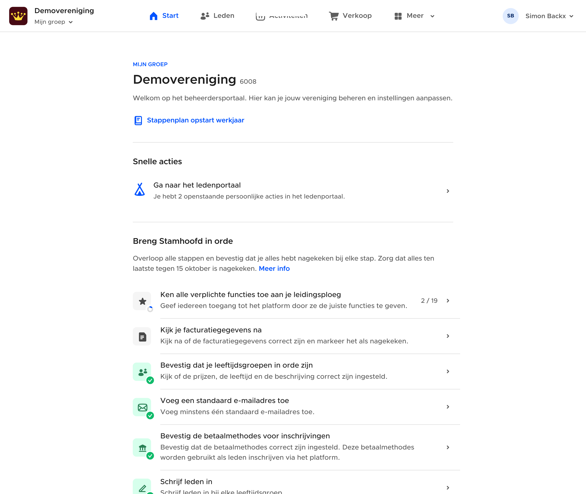
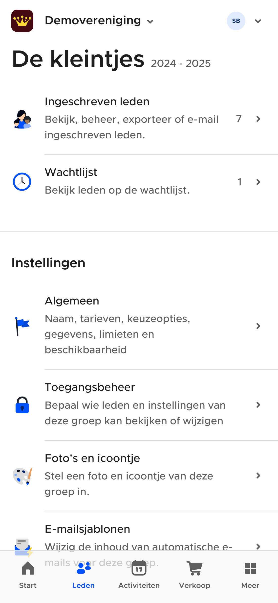

# Frontend controllers

Controllers contain views and decide which one is visible. Generic stacks and
responsive split panes are documented in
[vue-app-navigation's controller guide](https://github.com/SimonBackx/vue-app-navigation/blob/main/docs/controllers.md).
`NavigationController`, `SplitViewController` and `ModalStackComponent` come from
that library. The following containers belong to Stamhoofd.

## TabBarController

Tabs appear at the top on wide screens and at the bottom on narrower screens.
Switching tabs preserves the component instance and its internal scroll positions.
Reuse the `TabBarItem` objects rather than constructing fresh ones during rendering.
Reselecting the active tab can scroll it to the top, or reset its view when already
at the top; it is not equivalent to switching away and back.

In the setup of a view, with application components `StartView` and `MembersView`:

```ts
import { ComponentWithProperties, NavigationController, usePresent } from '@simonbackx/vue-app-navigation';
import TabBarController from '@stamhoofd/components/containers/TabBarController.vue';
import { TabBarItem } from '@stamhoofd/components/containers/TabBarItem';
import StartView from './StartView.vue';
import MembersView from './MembersView.vue';

const present = usePresent();
const tabs = [
    new TabBarItem({
        id: 'start', name: $t('Start'), icon: 'home',
        component: new ComponentWithProperties(NavigationController, {
            root: new ComponentWithProperties(StartView, {}),
        }),
    }),
    new TabBarItem({
        id: 'members', name: $t('Leden'), icon: 'group',
        component: new ComponentWithProperties(NavigationController, {
            root: new ComponentWithProperties(MembersView, {}),
        }),
    }),
];

async function openTabs() {
    await present({ components: [new ComponentWithProperties(TabBarController, { tabs })] });
}
```

The inner controllers give each tab its own show/pop stack. Use an explicit stable
ID when a tab should not derive its URL identity from its translated name.




Contracts: [TabBarItem](../../frontend/shared/components/src/containers/TabBarItem.ts)
and [TabBarController](../../frontend/shared/components/src/containers/TabBarController.vue).

## PromiseView

This loading/error container mounts a `ComponentWithProperties` returned by its
promise factory. Await the module import and select its default export:

```ts
import { ComponentWithProperties } from '@simonbackx/vue-app-navigation';
import PromiseView from '@stamhoofd/components/containers/PromiseView.vue';

const lazyView = new ComponentWithProperties(PromiseView, {
    promise: async () => {
        const { default: SettingsView } = await import('./SettingsView.vue');
        return new ComponentWithProperties(SettingsView, {});
    },
});
```

The factory runs on mount and when the exposed `reload()` is called. Failures
render an error box. The wrapper passes route checking and history ownership to
its child, and delegates the child's leave guard. Stamhoofd configures this as
`window.PromiseComponent` for library routes with async components or props.
See [PromiseView](../../frontend/shared/components/src/containers/PromiseView.vue).

## AuthenticatedView

[AuthenticatedView](../../frontend/shared/components/src/containers/AuthenticatedView.vue)
chooses `root` for a complete session, `loginRoot` when there is no token, and
optionally `noPermissionsRoot` for a complete session without nonempty permissions.
A token with an incomplete session remains in the loading state. Session loading
errors use the existing loading/error UI. This is frontend display selection,
not a substitute for backend authorization.
