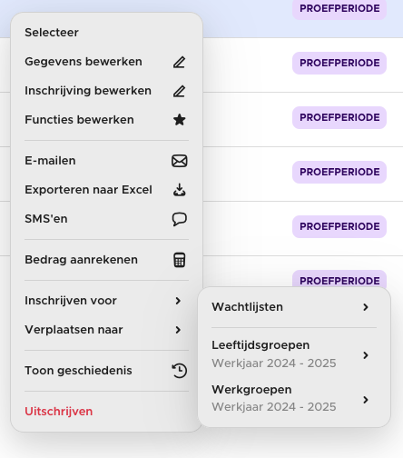
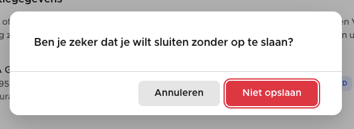
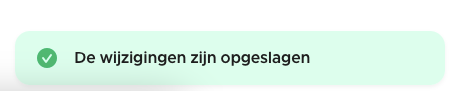
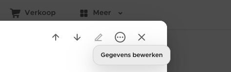

# View API’s

This guide describes API’s you can use in your views. For actual HTML/CSS helper classes and components, you can check out [View building blocks (inline components and classes)](building-blocks.md)

---

## Hooks

*Full API: `frontend/shared/components/src/hooks`*

Hooks are helpful small functions that you define in your setup hook of your component (**never use it anywhere else**). They are always prefixed with ‘*use*’.

The most commonly used hooks are:

**useOrganization / useRequiredOrganization**

Returns the current organization in scope. In Stamhoofd you can switch between multiple organizations. Some parts of the app have a scoped organization: e.g. the admin panel of a specific organization. Other parts don’t (always) have a scoped organization, such as the *platform portal* or the *member portal* when in platform mode (= Stamhoofd runs with shared members across all organizations).

The useOrganization hook, returns a **Ref** to the current organization, or null if there isn’t one in scope.

```typescript
const organization = useOrganization();

function clickButton() {
		alert(organization?.value.name);
}
```

**useContext**

Returns the current SessionContext — this contains data such as the currently logged in user. You’ll normally only use it for authentication checking of making requests in the frontend:

[Sending (authenticated) requests in the frontend](requests.md)

[Permission checking in the frontend (authorization)](authorization.md)

**useUser**

Returns a ref to the currently logged in user (if any).

**useAuth**

Used for permission checking / authorization.

[Permission checking in the frontend (authorization)](authorization.md)

**usePatch, usePatchableArray, useEmitPatch…**

Helper hooks for patching data in the frontend.

```typescript
const props = defineProps<{
    organization: Organization;
}>();

const { patched, hasChanges, addPatch, patch } = usePatch(props.organization);

const name = computed({
    get: () => patched.value.name,
    set: (value) => {
        addPatch({ name: value });
    },
});
```

[Patching data](https://github.com/SimonBackx/simple-encoding/blob/master/docs/patching.md)

[Patching inside views](patching.md)

---

## Translations

[Translations](translations.md)

---

## Formatters

*Full API: `shared/utility/src/Formatter.ts`*

All formatting is defined in the Formatter class. They can be accessed everywhere in the views without having to import (most of them\*).

```html
<template>
		<div>{{ formatPrice(123) }}</div> <!-- € 1,23 -->
</template>
```

```typescript
import { Formatter } from '@stamhoofd/utility';

const formattedPrice = Formatter.price(123);
// € 1,23 
```

All the available formatters are self-documented in the Formatter class.

\*The global available Formatters are defined in `frontend/vue.d.ts` and `frontend/shared/components/src/VueGlobalHelper.ts` — adjust if needed

---

## Context Menu’s

*Full API and options: `frontend/shared/components/src/overlays/ContextMenu.ts`*



**Displaying a menu at the mouse position**

```typescript
const menu = new ContextMenu([
    [
        new ContextMenuItem({
            name: $t(`Delete this item`),
            action: () => {
                doDelete();
                return true;
            },
        }),
    ],
]);
await menu.show({ clickEvent: event });
```

**Displaying below a button**

```typescript
const menu = new ContextMenu([
    [
        new ContextMenuItem({
            name: $t(`Delete this item`),
            icon: "trash",
            action: () => {
                doDelete();
                return true;
            },
        }),
    ],
]);
await menu.show({ 
		button: buttonHTMLElement,
		xPlacement: "right",
		yPlacement: "bottom"
});
```

**Deep menu’s**

```typescript
const menu = new ContextMenu([
    [
        new ContextMenuItem({
            name: $t(`Delete this item`),
            icon: "trash",
            action: () => {
                doDelete();
                return true;
            },
        }),
        new ContextMenuItem({
            name: $t(`Export...`),
            childMenu: new ContextMenu([
					    [
					        new ContextMenuItem({
					            name: $t(`Export to PDF`),
					            action: () => {
					                doExport();
					                return true;
					            },
					        }),
					        new ContextMenuItem({
					            name: $t(`Export to Excel`),
					            action: () => {
					                doExport();
					                return true;
					            },
					        }),
					    ],
					]);
        }),
    ],
]);
await menu.show({ 
		button: buttonHTMLElement,
		xPlacement: "right",
		yPlacement: "bottom"
});
```

---

## CenteredMessage

*Full API: `frontend/shared/components/src/overlays/CenteredMessage.ts`*



```typescript
const trueOrFalse = await CenteredMessage.confirm(
	'Are you sure?', 
	'Yes, confirm'
);
```

---

## Toasts



Toasts are small messages that are displayed at the bottom right corner of the display. By default they disappear automatically.

**Auto hiding Toast**

```typescript
Toast.info('Informative note').show();
Toast.success('Hello world').show();
Toast.warning('Warning: do this').show();
Toast.error('Something went wrong').show();
Toast.fromError(e).show();
```

**Manually hiding a Toast**

```typescript
const toast = Toast.success('Hello world').setHide(null);
toast.show();

//

// ...
toast.hide();
```

*Full API: `frontend/shared/components/src/overlays/Toast.ts`*

---

## Tooltips

When hovering an element for some times with your mouse, you can display a tooltip.



```typescript
<div v-tooltip="'Hello world'">
	Hello
</div>
```
