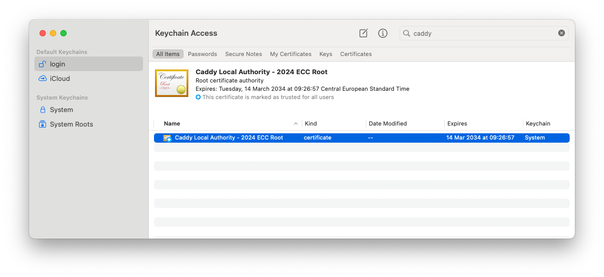
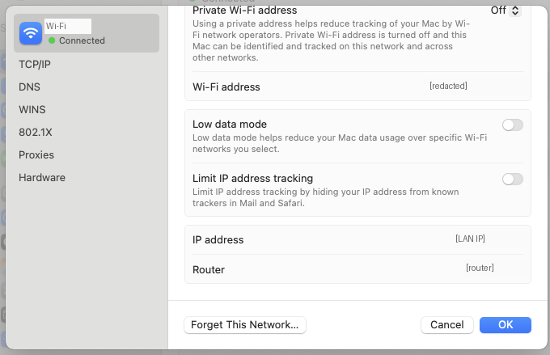

# Testing local development on iOS

This guide covers opening the local web apps in Safari on an iPhone. It does not cover building the native Capacitor app. Use a trusted private LAN, with the iPhone and development computer able to reach each other. Complete the normal [CLI setup](../../shared/cli/README.md) first.

## 1. Trust the local Caddy root certificate

Caddy creates local HTTPS certificates. The iPhone must trust the **same root CA** used by your development server, not an unrelated Caddy installation's certificate.

On macOS, open **Keychain Access**, search for `caddy`, and select the `Caddy Local Authority … ECC Root` certificate. Its year/name may differ from this example, and it may be in the System rather than login keychain. Choose **File → Export Items…** and export the certificate as `.cer`.



If needed, the CLI's [caddyRootCaPath](../../shared/cli/src/config/shared-service-config.ts) locates `pki/authorities/local/root.crt` under the Caddy data directory. On macOS the default data directory is `~/Library/Application Support/Caddy`; `XDG_DATA_HOME` overrides it. On Linux the default is `~/.local/share/caddy`. Transfer only the public root certificate, never `root.key`, a private key, or a certificate/key bundle. Do not commit either your local certificate or keys to the repository.

AirDrop the exported certificate to the iPhone. If that fails, transfer it through Files/iCloud and open it there. If prompted to choose between iPhone and Apple Watch, select iPhone.

1. Save the downloaded profile.
2. In **Settings → General → VPN & Device Management**, select the Caddy profile and install it.
3. In **Settings → General → About → Certificate Trust Settings**, enable full trust for that Caddy root. Installing the profile alone is not enough. Labels can vary with iOS language/version.

## 2. Find the computer's LAN address

Use the active Wi-Fi or Ethernet interface's local IPv4 address, not `127.0.0.1`. On macOS, find it in the network connection details. A computer with both Ethernet and Wi-Fi can have two addresses; the chosen interface must stay connected throughout testing.



## 3. Configure LAN DNS answers and restart services

The current CLI reads `PUBLIC_IP` from the process environment. Despite the variable's name, use the computer's **LAN** IP here. Do not follow the old `.development/.env` / `yarn dev:server` instructions.

Run from the repository root, replacing the example address:

```sh
export PUBLIC_IP=192.168.1.7
pnpm stam services restart
pnpm stam dev all
```

Keep `PUBLIC_IP` set in the shell used for these commands. [CoreDNS](../../shared/cli/src/services/definitions/coredns-service.ts) then answers development-domain A queries with that address rather than loopback. It also forwards other domains to upstream DNS. The development suffix defaults to `stamhoofd`; `STAMHOOFD_DOMAIN` can override it. Use the actual app URL printed by the CLI, including its instance/environment prefix.

On macOS, `PUBLIC_IP` also makes the shared DNS and Caddy container ports publish on all interfaces rather than only loopback. Restart is needed to change existing container port mappings. **This can expose other shared services too.** Use a trusted LAN and firewall, never an internet-facing host or router port forwarding; avoid exposing the Caddy admin API to untrusted devices.

**Linux limitation:** the current profile publishes CoreDNS on port `1053` and runs Caddy on loopback ports `8080`/`8443`, with local-machine redirects. Setting `PUBLIC_IP` changes DNS answers but does not change Caddy's Linux listen address. iOS manual DNS settings cannot specify port `1053`. The macOS procedure is therefore not an out-of-the-box Linux recipe: ask for an approved LAN DNS/proxy setup instead of assuming these commands make it reachable or changing runtime configuration as part of testing.

## 4. Configure the iPhone's DNS and test

In **Settings → Wi-Fi → your network → Configure DNS**, choose **Manual** and use the computer's LAN IP as the DNS server. For the macOS setup above, DNS is reachable on the standard port `53`. Remove competing DNS entries while testing so development hostnames are not sent to another resolver. Allow LAN DNS (UDP/TCP 53) and HTTPS (TCP 443) through the computer's firewall where appropriate.

Open the development app's HTTPS URL in Safari. Restart Safari if it keeps old DNS or certificate state.

- **Hostname does not resolve:** check the selected LAN IP/interface, manual DNS entries, `PUBLIC_IP`, restarted CoreDNS, firewall, and Wi-Fi client isolation/VPN settings.
- **Connection refused or timeout:** DNS can be correct while Caddy is unreachable. Check the host/platform limitations above and that services and the app instance are running.
- **Certificate warning:** confirm that the installed certificate belongs to the current Caddy CA and that full trust is enabled; do not bypass the warning.
- **Blank app or unresolved TLS/DNS problem:** stop and ask for help with the environment before continuing tests.

## Restore local-only development

After testing, restore the iPhone's Wi-Fi DNS to **Automatic** and remove the test CA profile/full trust when no longer needed. In the development shell:

```sh
unset PUBLIC_IP
pnpm stam services restart
```

Restart any development processes that inherited `PUBLIC_IP` as well. This resets the shared container mappings and CoreDNS answers to the local-only defaults. This migration verified configuration against code, not on an actual iOS device.
