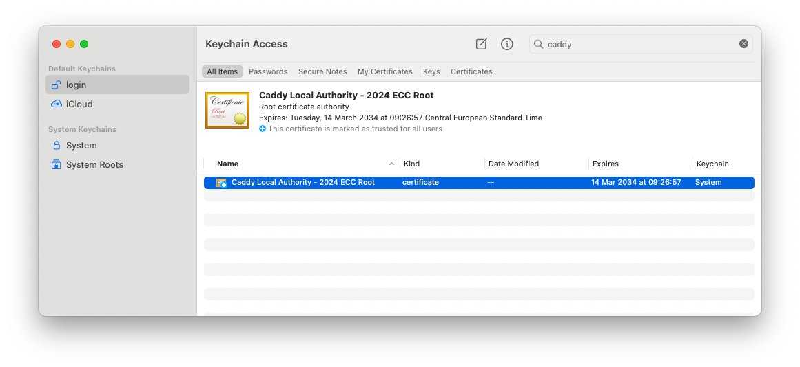
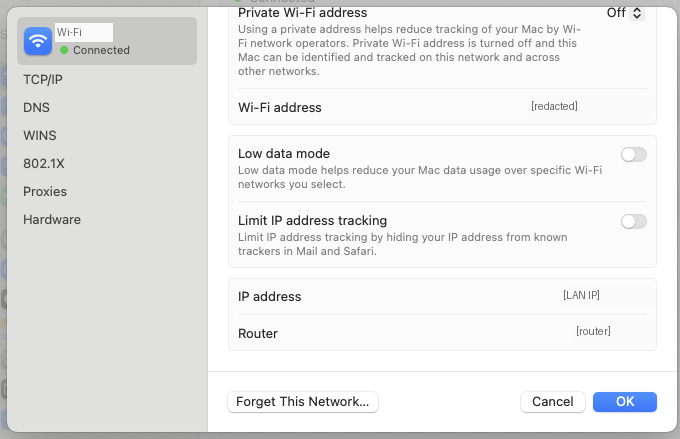

# Testing on iOS

## Installing root certificates

> This makes sure your iPhone trusts the certificates that your Caddy server on your local computer creates.

Next step is to download the Root caddy certificate on your computer. Easiest way is to open `Keychain Access` app. Select `login` on the left, and search for `caddy`.

You should see `Caddy Local Authority - 2022 ECC Root`. Select it and File -\> Export Items... Save as .cer.

Airdrop this file to your iPhone (if that doesn’t work, try saving it to iCloud and opening the file on your iPhone via the Files app).

You should get a popup (if you have an Apple Watch, it will ask whether to save it to your iPhone or Watch, choose iPhone). Save the profile.

Now go to your settings app on your iPhone. -\> General \> VPN and device management \> Click on ‘Caddy Local Authority...’ \> Install.

Go back to General \> Info \> Trusted certificates (at the end) \> Make sure ‘Caddy Local Authority’ is checked.

### Setting DNS-servers

You’ll also need to change the DNS-server to the local IP address of your computer. You can change this in the wifi settings on your iPhone

<strong>Finding your local IP</strong> You can find your local IP address on your Mac via the Wifi settings. Note, if you also connect via a cable, your Mac will have multiple local IP addresses (one for each interface), you can choose either one but your iPhone will no longer be able to connect to your Mac via this IP address if you disconnect the cable or Wifi.

### Change local resolution IP

Now you need to make sure your local DNS server on your computer returns the local IP address of your computer, and not the [localhost](http://localhost) address (the iPhone will ask the DNS server for the IP address of dashboard.stamhoofd → your DNS server needs to respond with the server that will answer to those requests, that is your local computer)

Change this in `.development/.env` and restart `yarn dev:server`

### Testing

You might need to restart Safari on iOS.

### Native scene lifecycle regression checks

The mobile iOS app uses `SceneDelegate` and the `Main` storyboard configured in
`UIApplicationSceneManifest`. Capacitor's `SceneDelegateProxy` receives scene
connection and link events, including links that launch the app.

After changes to the native lifecycle, run the `App` scheme in Xcode on an iPhone
and an iPad simulator/device:

1. Terminate the app and launch it. The web view should appear without the
   `UIScene life cycle is required` launch assertion.
2. Background and reopen the app. The existing screen should resume normally.
3. Open a supported universal link with the app terminated, then with it already
   running. Both should navigate to the linked screen.
4. Open any configured custom URL scheme in both states and verify its handler.

These checks require the native app; browser tests do not exercise UIKit's scene
lifecycle.
