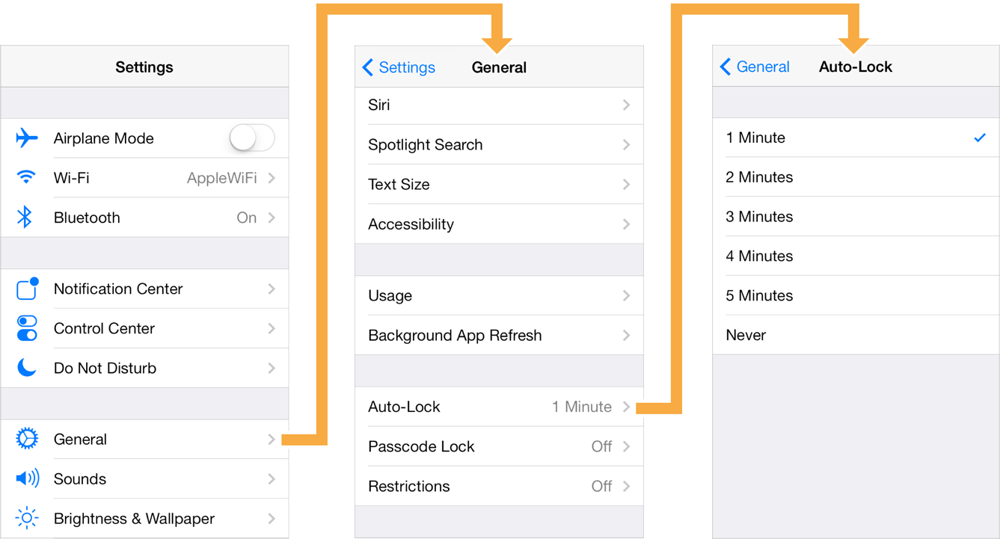
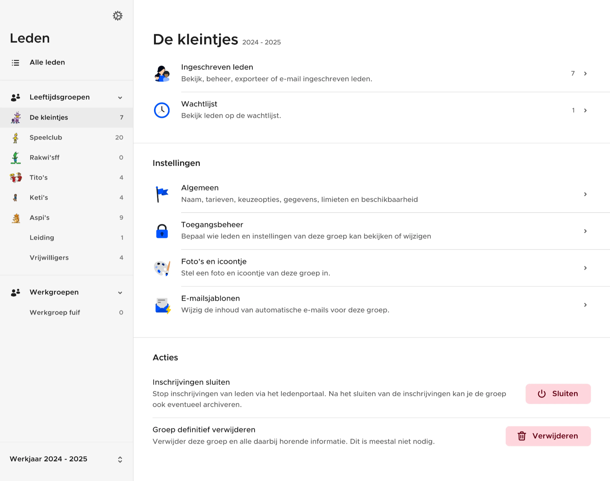
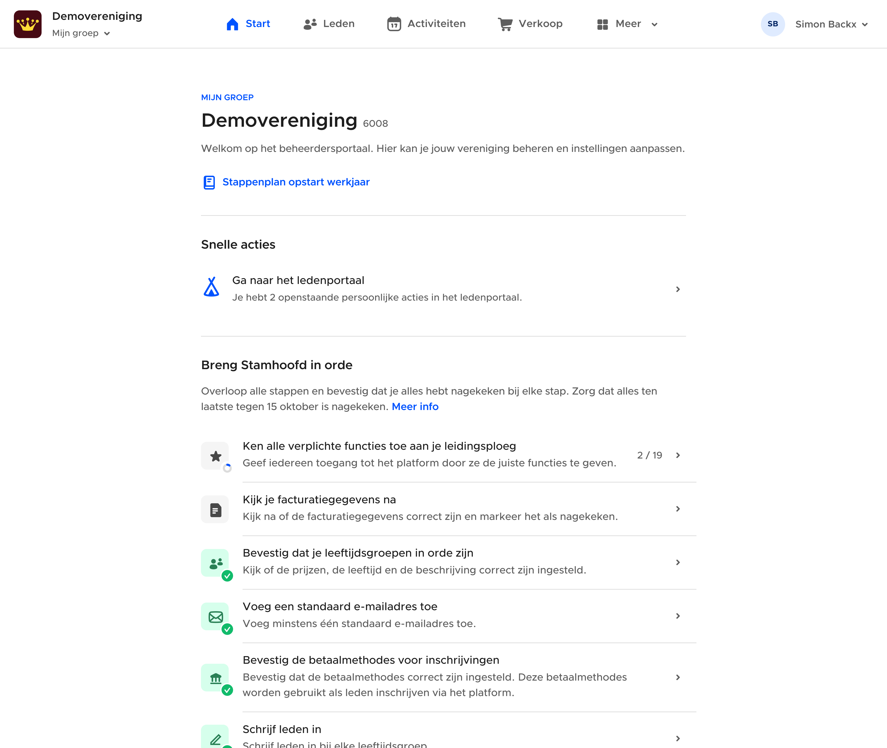

# Navigation controllers

You can not only just show or present views, sometimes you need to display views side by side or in a tab bar. This is what view controllers are for.

View controllers are container views that display multiple views at the same time, or keep track of a stack and when/how to display views.

Though the NavigationController and ModalStackComponent are the most important controllers, here is an overview of some other controllers that we use.

---

## **NavigationController**

To display a stack of views. The views cover each other. When one of the child views ‘shows’ a view, that view will be added to the navigation stack of this controller. Their scroll position and state is maintained when showing or popping views.



```typescript
new ComponentWithProperties(NavigationController, {
		root: new ComponentWithProperties(SettingsView, {});
});
```

You can also initiate it with multiple initial views. Only the last view will be visible, but you’ll be able to return to the previous views. This isn’t really used, but could be used to restore a checkout flow mid-flow.

```typescript
new ComponentWithProperties(NavigationController, {
		initialComponents: [
				new ComponentWithProperties(CartView, {}),
				new ComponentWithProperties(CustomerView, {}),
				new ComponentWithProperties(PaymentView, {})
		]
});
```

---

## **SplitViewController**

To display two views side by side. When you show a view in any child view using `showDetail` it will be presented on the right side of the split view controller.



```typescript
new ComponentWithProperties(SplitViewController, {
		root: new ComponentWithProperties(MenuView, {});
});
```

Inside MenuView:

```typescript
defineRoutes([
    {
        url: '@slug',
        name: Routes.Group,
        params: {
            slug: String,
        },
        // Show it on the right side (=detail view)
        show: 'detail',
        component: GroupView,
        paramsToProps: (params: { slug: string }) => {
            const group = groups.value.find(g => g.slug === params.slug);
            if (!group) {
                throw new Error('Group not found');
            }
            return {
                group,
            };
        },
        propsToParams(props) {
            if (!('group' in props) || !(props.group instanceof Group)) {
                throw new Error('Missing group');
            }
            return {
                params: {
                    slug: props.group.slug,
                },
            };
        },
        
        // The default view on the right side
        isDefault:{
            properties: {
                group: tree.value.getAllGroups()[0],
                period: period.value,
            },
        }
    },
]);
```

---

## **TabBarController**

Shows a tabbar at the bottom of the screen on mobile, or a tabbar at the top on desktop. You can switch between a set of defined views. Their scroll position and state is maintained when switching between views.




```typescript
const startTab = new TabBarItem({
    icon: 'home',
    name: $t(`Start`),
    component: startView,
});

const membersTab = new TabBarItem({
    icon: 'group',
    name: $t(`Members`),
    component: membersTableView,
});
    
const tabBarComponent = new ComponentWithProperties(TabBarController, {
    tabs: [startTab, membersTab]
});

await present({
		components: [tabBarComponent]
});
```

---

## PromiseView

Though the name of the file sounds as it is a view - technically it is more a controller. The PromiseView will display a view that will be returned by a promise.

```typescript
return new ComponentWithProperties(PromiseView, {
    promise: async () => {
        const LoadedComponent = import('...');
        return new ComponentWithProperties(LoadedComponent, {});
    },
});
```

---

## AuthenticatedView

Though the name of the file sounds as it is a view - technically it is more a controller. The AuthenticatedView will display one of a set of views depending on the authentication state of the currently logged in user.
