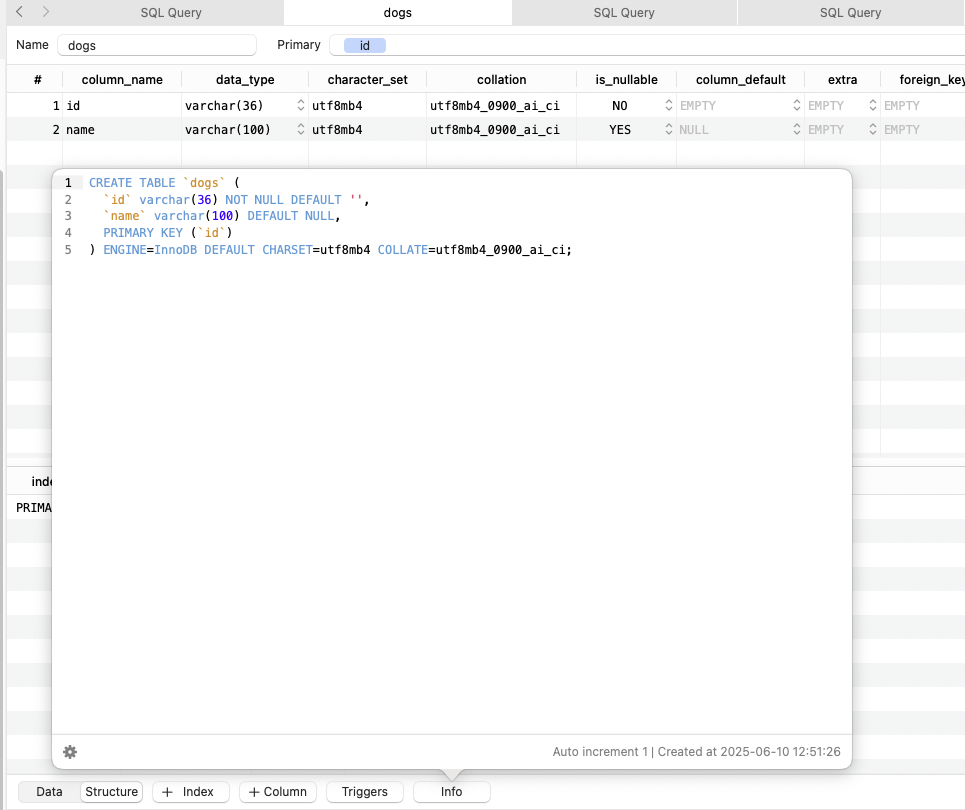

# Storing data in the database

Stamhoofd uses MySQL for data storage. The data in every table is mapped to a type safe Model object, which you can query and save to the database.

```typescript
const dog = new Dog();
dog.name = "Pablo";
await dog.save();

console.log(dog.id); // "119df7e7-b619-4c02-b6e8-2ade3e7ca4d7"
```

If no fields have changed, save won’t do anything

```typescript
const dog = new Dog();
dog.name = "Pablo";
await dog.save(); // does save

await dog.save(); // won't do anything
```

---

## Defining models

A model looks like this:

```typescript
export class Dog extends QueryableModel {
    static table = 'dogs';

    @column({
        primary: true, type: 'string', beforeSave(value) {
            return value ?? uuidv4();
        },
    })
    id!: string;

    @column({ type: 'string' })
    name: string;
    
    @column({ type: 'string', nullable: true })
    ownerName: string | null = null;

    @column({
        type: 'datetime', beforeSave(old?: any) {
            if (old !== undefined) {
                return old;
            }
            const date = new Date();
            date.setMilliseconds(0);
            return date;
        },
    })
    createdAt: Date;

    @column({
        type: 'datetime', beforeSave() {
            const date = new Date();
            date.setMilliseconds(0);
            return date;
        },
        skipUpdate: true,
    })
    updatedAt: Date;
}
```

*After you’ve created a new model, you’ll need to add a migration:* [Migrations](#migrations)

You can use the `beforeSave` method to define default values for models. This avoids expensive operations in the constructor of the classes (e.g. generating an ID).

Setting `skipUpdate` to true make sure that if you call `dog.save()` it won’t actually send a query to the database if that is the only column that was changed.

---

## Structures inside models

[Encoding & decoding (structures)](https://github.com/SimonBackx/simple-encoding/blob/master/README.md)

Models also support storing Encodeable data / structures. This data is stored in JSON columns. This is often used in Stamhoofd to store data properties that are not queried often but are needed. It simplifies the database design and often makes it more performant.

```typescript
export class Dog extends QueryableModel {
    // ...
    
		@column({ type: 'json', decoder: DogSettings })
    settings = DogSettings.create({}); // default is optional but recommended

    // ...
}
```

> Sometimes JSON data grows steadily over the years when we introduce more properties and more nested data. In that case we sometimes need to split up the data in multiple columns to speed it up. <br>*The only data bottleneck at the moment is when storing RecordAnswers, which can become very large for members. This is something on the todo list.*

```typescript
const dog = new Dog();
dog.name = "Pablo";
dog.settings = DogSettings.create({
		breed: "German shepherd"
});
await dog.save();
```

---

## Deleting data

Simply use the delete method.

**Delete a single model**

```typescript
await dog.delete();
```

**Delete where matching**

```typescript
await Dog.delete()
	.where('name', 'Pablo');
```

**Delete all**

```typescript
await Dog.delete();
```

---

## Querying data

> All models should extend `QueryableModel` to support this.

> Some legacy code still uses Dog.where(…). This is deprecated and should be avoided.

You can easily query data.

```typescript
const dogs = await Dog.select()
	.where('name', 'Pablo')
	.andWhere('createdAt', '<', new Date(2020))
	.fetch();
```

**Where IN**

```typescript
const pabloAndOtto = await Dog.select()
	.where('name', ['Pablo', 'Otto'])
	.fetch();
```

**Fetching a single row**

```typescript
// Throws if no dog was found:
const dog = await Dog.select()
	.where('name', 'Pablo')
	.andWhere('createdAt', '<', new Date(2020))
	.first(); // Dog
	
// Optional query
const optionalDog = await Dog.select()
	.where('name', 'Pablo')
	.andWhere('createdAt', '<', new Date(2020))
	.first(false); // Dog | null
```

**Fetching by ID**

```typescript
const optionalDog = await Dog.getByID(123);
```

**Counting**

```typescript
const count = await Dog.select()
	.where('name', 'Pablo')
	.count();
```

**Summing**

```typescript
const totalAge = await Dog.select()
	.where('name', 'Pablo')
	.sum(SQL.column('age'));
```

**Grouped or/and**

```typescript
const dogs = await Dog.select()
	.where('name', 'Pablo')
	.andWhere(
			SQL
				.where('ownerName', 'Simon')
				.or('ownerName', 'Bjarne')
	)
	.fetch();
```

**Looping data**

Avoid setting the limit of your query very high. If you need to loop over a very large portion of rows, use async loops.

```typescript
for await (const dog of Dog.select().all()) {
    // do something with dog
}

// Same as:
for await (const dog of Dog.select().limit(100).all()) {
    // do something with dog
}
```

You can also loop them in batches, so you won’t get an array of dogs per batch (by default 100).

```typescript
for await (const dogs of Dog.select().allBatched()) {
    // do something with 100 dogs at once
}

// Same as:
for await (const dogs of Dog.select().limit(100).allBatched()) {
    // do something with 100 dogs at once
}
```

You can limit the loop. This will loop 50 dogs at maximum, in batches of 10:

```typescript
for await (const dog of Dog.select().limit(10).all().maxQueries(5)) {
    // do something with dog
}
```

---

## Migrations

When making changes to columns or creating new models, you’ll need to write the SQL migration yourself. This doesn’t happen automatically.

**Create a new migration**

> New migrations should always receive a review in a PR. Don’t commit them directly to the main branch.

Get the current UNIX timestamp. This is used to order all migrations and run them in the right order.

```bash
➜  stamhoofd git:(main) date +%s
1749552474
```

Most migrations are stored in `backend/shared/models/src/migrations` - but it depends on where you add your Model. Create a new file that starts with your timestamp:

```bash
code backend/shared/models/src/migrations/1749552474-my-migration-name.sql
```

Use TablePlus to write your table scheme, and then copy over the schema into your migration:



**Running migrations**

To run migrations locally, use

```bash
yarn migrate
```
